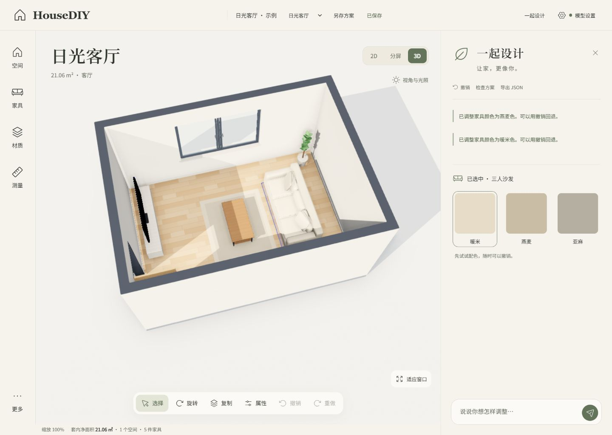

# HouseDIY

**在可编辑的 3D 空间里，和 AI 一起设计你的家。**

HouseDIY 是 Windows 桌面家居设计工具：导入户型图或已有方案，在同一界面中查看二维 / 三维效果、手动编辑，并通过对话逐步调整家具和空间。默认接入本机 Codex CLI，也支持自行配置 OpenAI 兼容模型 API。

[下载 Windows 预发布版](https://github.com/code-lawyer/HouseDIY/releases/tag/v0.1.7-rc.2) · [更新记录](CHANGELOG.md) · [问题反馈](https://github.com/code-lawyer/HouseDIY/issues) · [上游与许可](THIRD_PARTY_NOTICES.md)



截图展示 0.1.5 的暖居界面。配色、字体和交互约定见 [设计语言](docs/design-language.md)。

## 能做什么

- **从户型图开始**。上传 PNG、JPG 或 WebP，按左右最外墙的中线填写水平跨度，生成 1–3 套共用墙体、家具布置各异的可编辑方案。识图比例有差异时，导入结果会提示核对。
- **保留直接编辑**：继续使用原编辑器的二维、三维、家具库、属性面板和手动调整方式。
- **在页面里和 AI 协作**：例如「把客厅沙发改成暖米色」「再向右移动 20 厘米」「拆除选中的非承重隔墙，同时移走上面的挂画」。
- **可控地应用修改**。家具和材质修改可直接应用，墙体、门窗操作先确认。AI 会保护承重墙、承重待核实的墙及其洞口，识别出的墙须先核实结构。过期结果会提示重新生成。
- **项目保存在本机**。自动保存、复制方案、当前会话撤销，支持导出单层 JSON。导出的方案可携带所用自定义 GLB 的模型数据，便于搬到另一工作区继续编辑。
- **修改先检查**。AI 先在副本中检查门型、围合空间、门口通路、高柜位置和碰撞，收到问题后修正，通过后才进入应用流程。聊天区「AI 设计范围」默认固定墙体和门窗，需要改造时可以关闭。
- **删除与恢复项目**。项目卡片和编辑器顶部可将整个项目移入本地回收站，首页「回收站」可恢复方案、对话和历史。

## 下载与开始使用

**0.1.7-rc.2 预发布版**提供 Windows x64 便携程序，无需安装开发环境。导入户型图时会先保存底图，再用有效墙线建立可编辑的 3D 草稿。待定位的门窗可手动归墙，缺少墙线时可在底图上描墙或重新识别。具体规则见[设计检查说明](docs/design-checks.md)。[v0.1.5 公开预览版](https://github.com/code-lawyer/HouseDIY/releases/tag/v0.1.5)仍可下载。

1. 从 [v0.1.7-rc.2 Release](https://github.com/code-lawyer/HouseDIY/releases/tag/v0.1.7-rc.2) 下载 `HouseDIY-0.1.7-rc.2-portable.exe` 及其 `.sha256` 校验文件。程序尚未代码签名，核对 SHA-256 后双击启动。
2. 打开内置的「日光客厅 · 示例」，或导入 [示例 JSON](examples/demo-plan.json) 熟悉操作。
3. 在「模型设置」里选择 Codex CLI 或外部 API。
4. 导入自己的户型图，或导入原设计器导出的单层方案 JSON；在设计区选中对象后即可描述修改需求。

`public/index.html` 是界面源文件，直接在浏览器中打开只会显示启动指引。完整功能请从桌面程序进入。

### 使用 Codex CLI

需要自行安装并登录官方 [Codex CLI](https://github.com/openai/codex)。如果已安装 Node.js，可以执行：

```sh
npm install -g @openai/codex
```

HouseDIY 会检测本机 CLI；也可在高级设置中指定 `codex.exe`。在软件内点击「登录 Codex」完成设备登录。模型名称留空时使用 CLI 默认模型，无需另开 Codex 桌面窗口。当前集成验收使用 `codex-cli 0.153.4`；过旧版本需要更新。

账号、订阅及模型额度由用户自行提供。HouseDIY 不附带 Codex 登录凭据或模型权重。

### 使用其他 LLM API

选择「自定义 LLM API」，填写 OpenAI Chat Completions 兼容地址、API 密钥、聊天模型和可选的看图模型。聊天模型需要支持工具调用，看图模型需要支持图片输入。两套配置独立保留，切换后可以继续编辑同一项目。

## 数据与隐私

- 默认项目目录为 `%APPDATA%\HouseDIY\workspace`。旧 MyHouse 用户若已有项目，且新目录尚无项目，应用会沿用 `%APPDATA%\MyHouse\workspace`，保留项目与加密配置；不会自动合并两套工作区。
- 项目、最近 30 个历史版本及对话保存在本机；界面撤销针对当前打开的编辑会话。
- 完整备份可在关闭程序后复制整个 `workspace`，包括 `models` 中的模型原件。单方案 JSON 可带走当前布置及引用的模型，需要迁移全部方案、历史与对话时请复制整个工作区。旧项目若只剩模型编号，在编辑器按提示选回原始 GLB。
- **AI 请求会把当前方案及相关对话，或上传的户型图，发送给你选择的模型服务。** 没有后台自动上传；模型服务自己的数据政策与额度仍适用。
- 外部 API 密钥通过 Electron 的系统密钥存储加密，不放进导出的方案。Codex 凭据由 CLI 管理。
- 桌面服务只监听回环地址，使用会话鉴权；模型仅返回受校验的设计操作，不执行模型生成的任意代码。

## 当前边界

- 这是 **0.1.x 预览版**。识图得到的是设计初稿，尺寸、门洞、承重信息需要核对，不能替代现场测量或结构审核。
- 目前面向单层住宅和现有家具库；三维为可交互的参数化模型，不是照片级渲染。
- 不包含 PDF 图纸解析、云端同步、多用户协作或跨重启的一键撤销。
- 上游发布的是打包后的编辑器，未提供其构建源码和锁文件；部分内嵌依赖的精确版本仍未知。本项目保留原始许可并公开该限制，**不声称已完成上游所有内联代码的完整依赖审计**。详见 [THIRD_PARTY_NOTICES.md](THIRD_PARTY_NOTICES.md) 和 [依赖记录](vendor/DEPENDENCIES.json)。

## 本地开发

开发使用 Node.js 24；Windows 打包需要 Windows x64 环境。

```sh
git clone https://github.com/code-lawyer/HouseDIY.git
cd HouseDIY
npm ci
npm start
```

```sh
npm test             # 本地模拟模型与数据保存测试，不产生模型用量
npm run check        # 代码格式检查
npm run test:ui      # 浏览器界面回归，需要本机 Chrome / Edge
npm run test:first-fixes # 设计纠错、删除恢复与重启的隔离界面验收
npm run test:models  # 自定义模型重启、跨工作区导入和损坏恢复
npm run build        # 生成 release/HouseDIY-<版本>-portable.exe
npm run test:package # 在隔离数据目录验收真实便携包，不调用模型
```

`npm run serve` 可启动网页开发模式；系统密钥存储和原生导出对话框需要 Electron。测试输出位于被 Git 忽略的 `.qa` 目录。`HOUSEDIY_DATA_DIR` 可指定独立桌面数据目录；`HOUSEDIY_PLAN_FIXTURE` 可指定成品验收用的方案文件。

## 项目结构与归属

| 路径                               | 作用                                      |
| ---------------------------------- | ----------------------------------------- |
| `src/main.cjs` / `preload.cjs`     | Electron 桌面入口、受限 IPC、系统密钥存储 |
| `src/server.mjs` / `store.mjs`     | 本地会话服务、项目、版本及保存            |
| `src/codex.mjs` / `ai.mjs`         | Codex CLI 与兼容 API 的模型接入           |
| `src/model.mjs` / `operations.mjs` | 设计操作契约、承重保护与几何校验          |
| `public/`                          | 桌面外壳、AI 对话和原编辑器桥接           |
| `vendor/`                          | 固定版本的上游编辑器、家具目录与许可      |
| `examples/` / `tests/`             | 无私人数据的示例与自动测试                |

HouseDIY 的桌面外壳、项目存储、模型适配、对话编辑与识图转换为本项目代码。二维 / 三维设计器、家具渲染、手动工具与布局检查来自 [ZWD11/house-plan-designer](https://github.com/ZWD11/house-plan-designer)，固定提交为 `dd5a61070ea0a251fb13a141cd9a282be36fd292`，不作为 HouseDIY 原创能力宣称。

本项目新代码采用 [MIT](LICENSE)。上游及第三方署名见 [Third-party notices](THIRD_PARTY_NOTICES.md)。HouseDIY 是独立项目，不是 OpenAI 或上游设计器的官方产品。

欢迎提交脱敏后的问题与改进建议，开发约定见 [CONTRIBUTING.md](CONTRIBUTING.md)。
