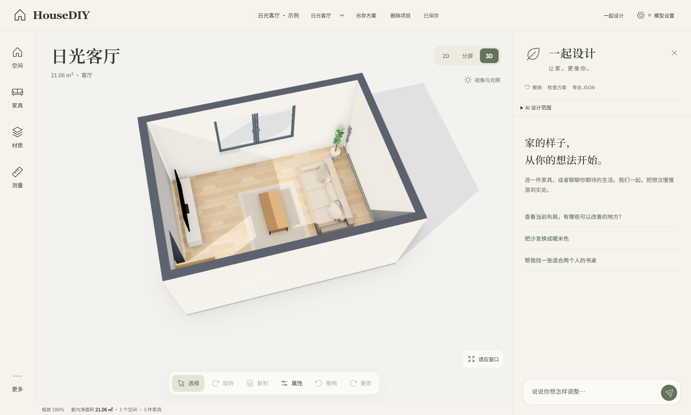

# HouseDIY

HouseDIY 是面向单层住宅的 Windows 桌面设计工具。导入户型图后，可以在 2D、3D 或分屏里描墙、布置家具，也可以用 AI 生成布局，再通过对话或手动编辑调整方案。

[下载 Windows x64 便携版](https://github.com/code-lawyer/HouseDIY/releases/download/v0.1.7-rc.4/HouseDIY-0.1.7-rc.4-portable.exe) · [SHA-256 校验文件](https://github.com/code-lawyer/HouseDIY/releases/download/v0.1.7-rc.4/HouseDIY-0.1.7-rc.4-portable.sha256) · [v0.1.7-rc.4 发布说明](https://github.com/code-lawyer/HouseDIY/releases/tag/v0.1.7-rc.4)



## 快速开始

1. 下载便携 EXE 和校验文件。当前是未签名的测试版。在下载目录运行以下 PowerShell 命令，比对校验文件中的 SHA-256，确认一致后双击 EXE。

   ```powershell
   Get-FileHash -Algorithm SHA256 -LiteralPath .\HouseDIY-0.1.7-rc.4-portable.exe
   ```

   从旧版升级时，请先退出程序并备份整个 `workspace`。rc.4 会在下次保存旧项目时将图片迁移到 `workspace/images`。回退到 rc.3 时请还原升级前的工作区备份。

2. 打开内置的「日光客厅 · 示例」，试试切换视图、移动家具或更改材质。手动编辑和查看示例无需配置 AI。
3. 选择「导入户型图」上传 PNG、JPG 或 WebP，也可用「导入已有方案」继续编辑单层方案 JSON。 [示例 JSON](examples/demo-plan.json)
4. 想用 AI 识图或调整方案时，先在「模型设置」选择连接方式，再在编辑器的「一起设计」侧栏提出需求。 [配置 AI](#配置-ai)

## 户型设计与导出

- **识图和描墙。** 导入后会保留可下载的原图。填写两侧最外墙中线的水平跨度可校准尺寸。AI 可生成 1–3 套共用墙体、家具布局各异的方案。识别中断后仍可打开底图或已生成的草稿，继续描墙、重试或手动定位门窗。
- **手动与对话编辑。** 可以选中家具再说「把沙发换成暖米色」或「向右移动 20 厘米」。应用 AI 修改前会检查门口通行、碰撞等问题。AI 默认固定墙体与门窗。解锁后，相关修改需确认，承重墙与结构待核实的墙仍受保护。 [设计检查说明](docs/design-checks.md)
- **保存与分享。** 项目自动保存在本机，可另存方案或撤销当前会话中的编辑。回收站支持恢复项目、永久删除单项以及清空。单层 JSON 可随附所引用的自定义 GLB，便于继续编辑。独立 HTML 可离线打开，A3 PDF 可用于沟通设计。
- **尺寸与结构。** 识图和 PDF 图纸提供设计草稿。尺寸、门洞和承重信息需按现场测量与结构审核确认。

## 配置 AI

打开「模型设置」，在以下两种连接方式中选择一种。两套设置分别保存，切换后可以继续编辑同一项目。

- **本机已登录的 Agent。** 在终端安装并登录 Codex CLI、Claude Code CLI 或 Gemini CLI，再在 HouseDIY 中选择对应的 CLI 并点击「检测 CLI」。可在「CLI 路径与安装」里填写程序路径，模型留空时使用 CLI 默认模型。服务权限和额度由各 CLI 的账号管理。 [Codex CLI](https://github.com/openai/codex) · [Claude Code CLI](https://code.claude.com/docs/en/cli-reference)
- **外部 LLM API。** 填写 OpenAI Chat Completions 兼容地址、API 密钥和模型名称。远程服务使用 HTTPS，本机回环地址支持 HTTP。聊天模型需支持工具调用，识图需使用支持图片输入的模型。

Gemini CLI 入口面向符合资格的组织账号，识图依赖 CLI 的 ACP 图片能力。Claude Code 连接使用用户自行安装和登录的原版 CLI，适用 Anthropic 的接入条款。 [Gemini CLI 官方说明](https://github.com/google-gemini/gemini-cli#gemini-cli) · [Claude Code 条款](https://code.claude.com/docs/en/legal-and-compliance#can-customers-offer-claude-code-in-their-products)

本版的自动验收使用模拟 CLI 和模拟 API 响应。 [本版验收记录](https://github.com/code-lawyer/HouseDIY/releases/tag/v0.1.7-rc.4)

## 数据与隐私

- 默认工作区是 `%APPDATA%\HouseDIY\workspace`。若新工作区尚未初始化，程序会优先打开已有的 `%APPDATA%\MyHouse\workspace`，两套工作区各自保存。
- 要备份全部项目、对话、历史、原图和自定义模型，退出程序后复制整个 `workspace` 目录。换电脑后按需重新配置模型连接。
- 发起 AI 请求时，所选服务会处理当前方案及相关对话，或用于识图的缩放图。导入原文件保存在本机。API 密钥由 Windows 系统密钥存储保护，各 CLI 管理自己的登录。

## 从源码运行

仓库提供的 `scripts/upgrade-portable.ps1` 可在 Windows 上核对同名 `.sha256` 文件、备份并校验工作区，再更新桌面快捷方式。

使用 Node.js 24。以下命令检出当前测试版对应的源码。Windows x64 环境可构建便携程序。

```sh
git clone https://github.com/code-lawyer/HouseDIY.git
cd HouseDIY
git switch --detach v0.1.7-rc.4
npm ci
npm start
```

| 命令                       | 用途                                   |
| -------------------------- | -------------------------------------- |
| `npm test`                 | 运行项目存储、设计规则与模拟模型测试   |
| `npm run check`            | 检查代码与 README 格式                 |
| `npm run test:ui`          | 使用本机 Chrome 或 Edge 做界面回归     |
| `npm run test:first-fixes` | 验收设计纠错、项目删除和恢复           |
| `npm run test:models`      | 验收自定义模型持久化及损坏恢复         |
| `npm run build`            | 将 Windows x64 便携包输出到 `release/` |
| `npm run test:package`     | 在隔离数据目录验收便携程序             |

`npm run serve` 可启动网页开发模式。系统密钥存储和原生文件对话框在 Electron 中可用。测试输出位于 `.qa/`。

## 反馈与许可

反馈时请附上版本号、复现步骤和脱敏后的截图或样例。 [提交问题](https://github.com/code-lawyer/HouseDIY/issues) · [贡献指南](CONTRIBUTING.md) · [更新记录](CHANGELOG.md)

HouseDIY 新增代码采用 MIT 许可。二维与三维设计器、手动布局工具和家具渲染来自 ZWD11 的 house-plan-designer。仓库保留上游的编译产物与许可，部分内嵌依赖版本仍待核实。 [MIT 许可](LICENSE) · [上游项目](https://github.com/ZWD11/house-plan-designer) · [第三方许可与版本说明](THIRD_PARTY_NOTICES.md)
