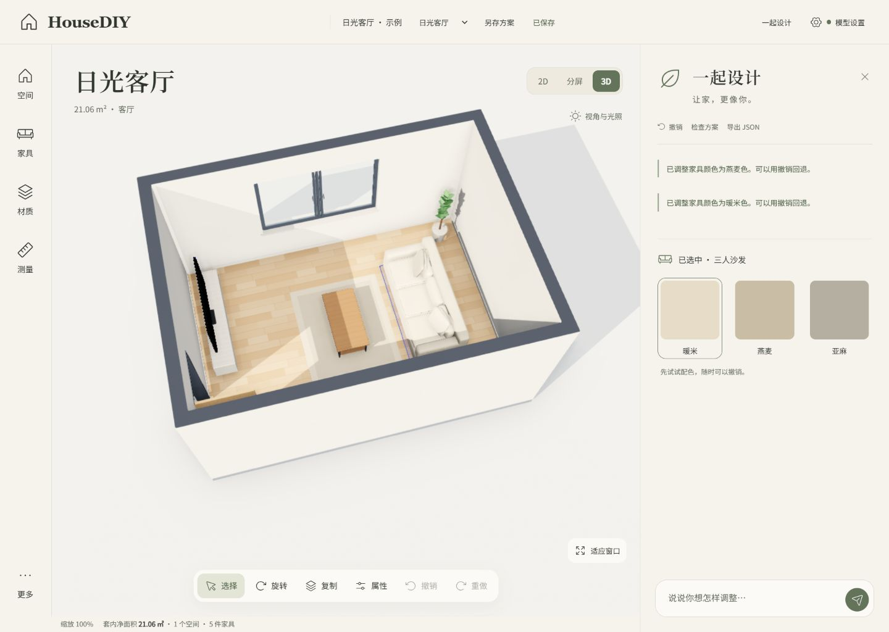
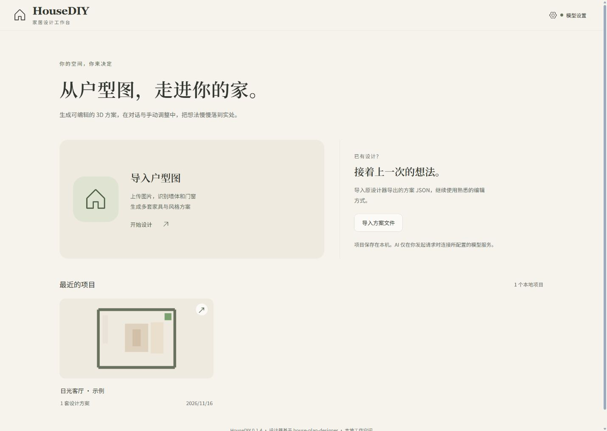

# HouseDIY · 暖居工作台

选定方向为方案 1：奶油白、鼠尾草绿和自然木色，配合宋体标题、清晰的中文操作文字与轻量线性图标。界面留出足够空间展示用户的家，工具按需展开。

[选定方案参考](design/option-1.png)

## 颜色与字体

公共变量统一维护在 `public/design-tokens.css`，桌面外壳和内嵌编辑器共同使用。

| 用途           | 变量          | 色值      |
| -------------- | ------------- | --------- |
| 页面底色       | `--paper`     | `#f6f3ed` |
| 次级底色       | `--linen`     | `#eeeadf` |
| 浮层与输入区域 | `--surface`   | `#fcfaf6` |
| 主要文字       | `--ink`       | `#30352d` |
| 辅助文字       | `--muted`     | `#62695c` |
| 分隔线         | `--line`      | `#deddd2` |
| 品牌强调       | `--sage`      | `#64745a` |
| 主要按钮       | `--sage-deep` | `#4e6046` |
| 选中背景       | `--sage-soft` | `#e3e5d6` |

标题使用中文衬线字体栈，优先本机 Noto Serif SC / 思源宋体，回退中宋、宋体。界面文字使用随应用离线提供的 Noto Sans SC 常规字重，按钮保持清晰的字号和足够留白。大标题负责气质，辅助信息保持克制。

图标使用 Phosphor Light 2.1.1，来源与许可在 `THIRD_PARTY_NOTICES.md`。所有新图标均为本地资源。

## 页面与交互

- **首页**：以“从户型图，走进你的家。”作为入口标题，突出户型导入，已有方案和最近项目保持独立入口。
- **编辑区**：左侧细导航、居中的二维 / 三维画布、底部常用操作条。家具库和属性面板按需展开；完整工具放在“更多”，视角和灯光放在“视角与光照”。
- **一起设计**：右栏保持温和、直接的语气。选中家具时显示三种配色，点击后应用到实际对象，写入历史并保存；可撤销。
- **输入区**：默认单行，随内容扩展；发送、停止、处理中的状态沿用现有请求流程。
- **内容滚动**：消息、配色和待确认修改共用独立滚动区，输入区固定在底部；可用键盘滚动查看较长内容。重复点击已应用的颜色只提示未作修改，不新增操作记录。
- **状态**：选中使用浅绿底，主要动作使用深绿；失败与警告保留明确的独立颜色。聚焦轮廓、按钮名称、展开状态和减少动效偏好均保留。
- **小窗口**：逐步缩减工具间距，窄屏将对话栏改为覆盖面板；发送和设置入口保持可见。

## 后续维护

`public/editor-workspace.js` 只负责调整原编辑器的呈现和入口，复用原始工具与历史；`public/editor-theme.css` 提供主题覆盖。固定的 `vendor/designer.html` 本次没有改写。

配色卡当前修改家具颜色，不代表更换布料贴图。画布、选中轮廓与家具几何由现有实时渲染器生成。新增界面应延续上述变量、字体与控件状态，避免每个页面另起一套样式。

设计验收记录见 [design-qa.md](../design-qa.md)。后续已打包为 HouseDIY 0.1.5 Windows x64 便携版并通过成品验收，详见 [验收记录](releases/0.1.5-local.md)。

后续代码与界面复查见 [审查修复记录](reviews/2026-11-16-atelier-review.md)。
