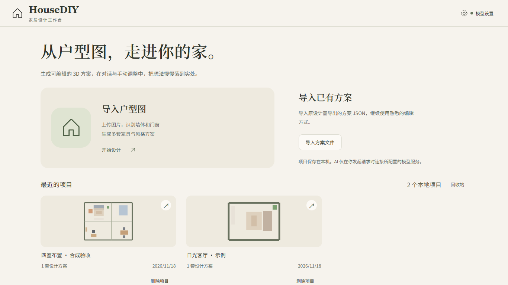
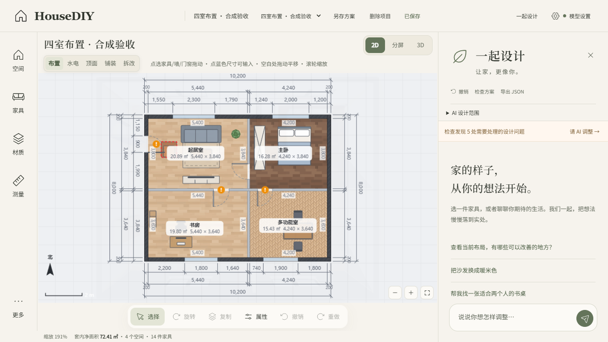
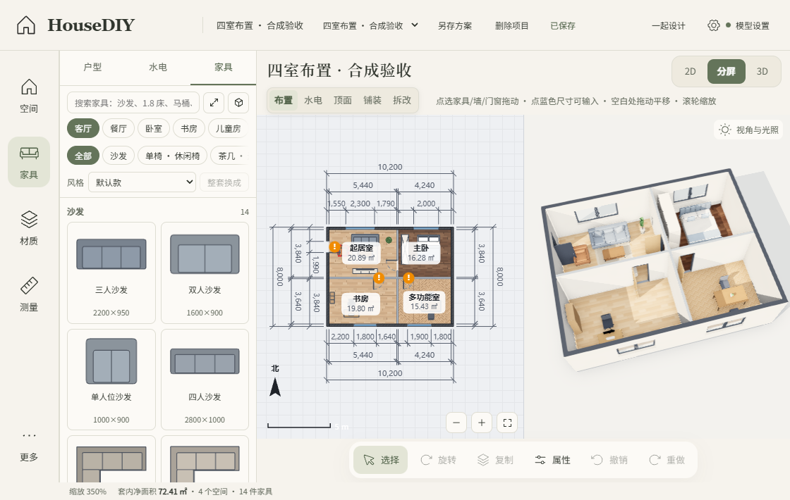

# HouseDIY 0.1.7-rc.1 发布前综合验收

2026-11-18，Windows x64 便携版。本轮以桌面应用及其内置编辑器为对象，使用公开示例、合成图纸与隔离工作区。验收没有读取私人装修项目，也没有替换用户已安装的版本。

**适合小范围 Windows x64 Beta，建议暂缓公开稳定版。** 用户可以导入单层户型，获得可编辑的设计草案，在二维与三维之间切换，通过对话或手动继续调整，保存、迁移并分享结果。真实模型跑通了简单户型，复杂户型的识别准确率、现场适用性和跨机器表现仍缺验收数据。

本地交付文件为 `release/HouseDIY-0.1.7-rc.1-portable.exe`，共 115,513,588 字节。SHA-256 为 `e9ff27a23cd61ea255f7680503b2773a838b35be0401397e949c3dcbc9b27cb5`，同目录提供校验文件。

同一台机器直接运行最终 EXE 两次。Intel Arc 140T / Direct3D 11 和 SwiftShader 软件渲染各通过 **9/9** 项，15 个启动资源全部加载，两次均无跳过项、页面异常或资源请求失败。硬件渲染用的是本轮真实识图产生的方案，软件渲染用的是内置公开示例。另从最终 EXE 解出应用归档，逐字节核对 61 份源文件、资源和许可，并核对第 62 份文件的产品元数据。归档不含 `node_modules`、用户工作区或测试样本。

## 从设计目的到实测结果

| 要完成的事                 | 验证方式与结果                                                                                                                                                                     |
| -------------------------- | ---------------------------------------------------------------------------------------------------------------------------------------------------------------------------------- |
| 把一张户型图变为可编辑方案 | 用本机已登录的 Codex 读取合成图，40 秒生成 6000 × 4200 mm 的单房间，4 面墙、1 扇门、1 扇窗和指定的 1 张茶几。重新打开后查到原图与方案。                                            |
| 一次取得指定数量的布局     | 用可控模型对 10 m / 1 套、8 m / 2 套、12 m / 3 套分别生成，重启后核对跨度、底图比例与套数。模型持续少给的用例收到两次机会，最终给出失败原因，项目库中没有半成品。                  |
| 对话编辑可预期且能保存     | 用真实 Codex 在公开样例中仅改选中的沙发，13 秒得到与指定值相同的颜色 `#a5b49a`，逐字段比对其余方案，重新读盘得到同一颜色。取消、撤销、过期回复、结构确认、并发保存另有自动化回归。 |
| 用二维、三维及分屏继续设计 | 用四室、14 件家具的合成方案操作家具库、切换视图、查看尺寸、结果定位和导出。检查桌面、笔记本、最小窗口及放大界面，截取实际画面。                                                    |
| 保存、迁移并恢复设计       | 自定义 GLB 在新服务端口和空白工作区回读后仍渲染原始蓝色网格。被移入回收站的项目可恢复所有方案、历史和对话，损坏的项目单独列出文件级诊断。                                          |
| 把结果交给别人             | 由实际导出菜单生成四室样例的 12 页 A3 横版 PDF 和毫米 DXF。分享 HTML 在断网 Chrome、Edge 可旋转、缩放和漫游，带自定义家具和校准底图的样例也通过独立文件回读。                      |

## 这轮修掉的问题

| 问题                                                   | 修复与复测                                                                                                                                              |
| ------------------------------------------------------ | ------------------------------------------------------------------------------------------------------------------------------------------------------- |
| 模型猜测的比例覆盖用户填写的尺寸，要求多套却能只交一套 | 用左右最外墙中线的水平跨度校准几何与底图，对模型比例差异给出提示。检查每套家具布局的实际不同之处，重试后仍不满足则停止创建项目。                        |
| 将图片推断的墙体当成可拆隔墙                           | 保留「承重」「非承重」「待核实」三种状态。AI 对墙、洞口和共用端点的修改，以及手动拆改入口，均检查结构状态。用户核实后可以在原始结构阶段明确标记隔墙。   |
| 低家具挡门、狭窄通道几乎被占满也能通过                 | 将家具高度、门扇活动区及通行净宽纳入检查。复测识别出底部离地 300 mm 的茶几挡门，以及沙发占去 880 mm 通道中的 870 mm，保留可绕行和逐步改善旧问题的用例。 |
| 自定义家具重开后变成方块，导出时丢模型                 | 将 GLB 保存到工作区并校验内容，单方案 JSON 带走引用的模型。损坏文件可用原 GLB 补回，保留损坏副本，已有校验值时会拒绝错误替代文件。                      |
| 坏项目拖垮项目库，旧目录和设置出错后容易打开错误数据   | 将损坏项目与可用项目隔离，错误给出文件名及字段。修正旧工作区选择、损坏设置的保护与备份，以及跨方案同时校准底图时的写入冲突。                            |
| 笔记本首屏看不到项目名，工具遮住图纸和尺寸             | 1366 × 768 首页第一张卡片的标题由距顶部 924 px 提升到 676 px。二维标题和工具移出图纸，1120 px 宽的分屏打开家具库后仍保留两块画布，关闭面板可恢复对话。  |
| 离线分享文件仍查找桌面服务资源                         | 导出时移除桌面脚本、样式和初始项目副本，独立嵌入当前方案所用模型和校准底图。两个断网浏览器均记录到 0 次联网尝试、0 个缺失本地资源和 0 个页面异常。      |

## 工程质量和验证范围

- 自动测试 **62/62**。覆盖设计规则、模型操作、项目与模型存储、历史兼容、会话、并发与错误恢复。浏览器一般流程 **17/17**，设计纠错及回收站流程 **10/10**，自定义模型与离线分享回归 **7/7**。界面的七种状态抽查了 125 处文字对比度，抽样中未出现失败、未命名控件或横向溢出。完整读屏体验仍待人工验收。
- 12 个项目、每个 120 件家具且保留 18 条历史的同一组合样本，首页从 13 次请求和 4,308,641 字节降到 1 次和 101,828 字节。首次从磁盘建立摘要约 124 ms，热缓存中位约 2.3 ms。3000 件间隔摆放家具的规则检查中位从约 1226 ms 降至 14.9 ms。以上为本机合成基准。
- 将固定上游编辑器的适配集中到单一模块，启动时验证每一处匹配。上游 HTML 文件的 SHA-256 仍为 `39c247940912c0b9ec4b244576b41f60da85a2628a35fb1d71b19e0cdc3ff75b`。Windows CI 配置已加入浏览器回归、打包与成品检查，本轮在本机执行，远端工作流尚未运行。 [依赖清单](../../vendor/DEPENDENCIES.json)
- 外部兼容 API 的工具调用、识图、回退和错误路径通过本地模拟服务验证。真实模型证据仅覆盖上表两次 Codex 调用。模型样本量不足以估计普通用户首次识图成功率。

## 画面与图纸

**首页，1366 × 768。** 两个导入入口与最近项目的缩略图和名称在同一屏内可见。

**二维，1366 × 768。** 四室方案、内外尺寸、工具栏和检查提示同时可见。样例故意留下通行问题，以检查提示与定位。

**分屏，1120 × 710。** 家具库打开时仍能同时操作二维和三维，两块画布各宽 378 px。

四室样例的 PDF 为 3,530,876 字节。12 页均已渲染查看，页面约为 1190.55 × 841.89 pt。另单独放大核对了布置页的尺寸、比例标注及预算页的表格。DXF 为 154,074 字节，文件单位为毫米，解析出 254 个实体，其中有 27 个尺寸标注。现场测量、打印比例与实际施工预算仍须由使用者复核。

## 正式稳定版的剩余条件

1. **Windows 分发。** 本地候选 EXE 尚无 Authenticode 签名。本轮测试限于一台 Windows 机器；需要补充干净机器、不同显卡与已有工作区升级验收。
2. **构建依赖。** npm 开发依赖审计报告 9 个 high 条目，追溯到同一条 `picomatch` 公告；核查时上游尚无修复版本。生产 npm 依赖审计为 0，打包器使用开发依赖。Electron 二进制和固定上游 HTML 中部分内联组件仍须单独跟踪。 [上游安全公告](https://github.com/advisories/GHSA-fc5q-39xc-vjpf) · [第三方说明](../../THIRD_PARTY_NOTICES.md)
3. **真实设计样本。** 补充经授权的复杂户型，按实测标注核对尺寸、门窗、原图校准和多方案可用性，并完成外部兼容模型的端到端验收。现有通行规则采用近似栅格，接近阈值的位置、承重判断和工程合规性都需要专业复核。 [设计检查说明](../design-checks.md)

本轮原始数据保存在本机 `.qa/release-check-2026-11-18/`。真实模型记录在 `live-chat.json` 和 `live-image.json`，浏览器证据在 `release-ui`、`release-checks`、`models-final` 与 `offline`。导出物和图纸检查见 `final`、`drawing-files.json`。成品记录见 `final-package-software`、`final-package-system` 和 `package-content.json`。GitHub 的最新公开包在验收时为 [v0.1.5](https://github.com/code-lawyer/HouseDIY/releases/tag/v0.1.5)。
