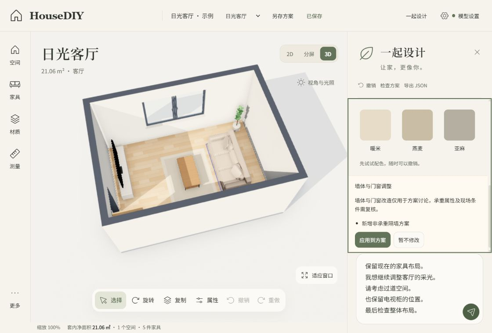

# 方案 1 · 代码与界面审查修复

日期：2026-11-16。结果：本轮确认的问题均已修复，验证通过。

审查基准：`5c03a946eb4122f03a07f2a13dfcda19dc0b1337`。改版尚未提交，故使用 `git diff 5c03a946eb4122f03a07f2a13dfcda19dc0b1337 --`，同时审查 `git ls-files --others --exclude-standard` 中的新增文件；没有基准之后的新提交。需求源是用户“前端风格和设计语言要有高级感和一定亲和力”及选择方案 1，参考为 `docs/design/option-1.png`。

Standards 与 Spec 由两名独立审查代理并行完成；主代理负责界面实测、修复和验证。没有修改固定上游编辑器、正式用户项目或模型配置。

## Standards

**[P2，已修复] 新增配色同步和持久化路径缺少行为测试。**

`CONTRIBUTING.md` 要求 “Keep changes to project persistence, AI operations and editor synchronization covered by behavioral tests.” 原界面测试覆盖 AI 修改，未经过 `public/editor-bridge.js` 的 `color` RPC，也未验证 `public/app.js` 的色块操作。

已在 `scripts/qa-regressions.mjs` 增加实际点击色块、保存、撤销、切换方案并重新打开、拒绝过期选择及同色无操作的完整验证。不是只断言实现细节的单测。

本轴合计 1 项，最高 P2，已解决。未发现需要重构的基线 smell；现有 CSS 覆盖层和上游 DOM 适配有明确兼容目的。资源路由鉴权、路径限制、字体图标许可和固定 vendor 约束保持有效。

## Spec

**[P2，已修复] 同色点击产生虚假的可撤销记录。**

`README.md` 承诺“当前会话撤销”。原逻辑对已应用颜色仍记录“已调整，可以撤销”，而上游相同快照不会新增历史；用户随后撤销会回退到更早的修改。

`public/editor-bridge.js` 现在比较归一化后的颜色，只在真正变化时提交历史，并返回 `changed`。`public/app.js` 对无变化提示“已经是…色，未作修改”，不保存或追加成功记录。新增回归验证同色点击不追加记录，撤销仍正确回到换色前。

本轴合计 1 项，最高 P2，已解决。旋转、复制、测量的入口连接现有编辑行为；未发现明确范围扩张。该轴提出的组合布局候选由主代理实测确认，记入下方 Impeccable，避免重复计数。

## Impeccable

实现完整性结论：通过。保留已选定的暖居设计语言，修复真实任务障碍；没有为检测器的机械偏好替换整个视觉方案。

| 维度       | 修复后评分 | 依据与边界                                                                            |
| ---------- | ---------- | ------------------------------------------------------------------------------------- |
| 可访问性   | 3/4        | 命名滚动区域可键盘聚焦和滚动，焦点可见；窄屏功能文字提高到 11px。不是完整 WCAG 认证。 |
| 性能       | 3/4        | 未增加运行依赖；资源本地提供。完整中文字体约 10.6MB，未测低端设备首帧。               |
| 响应式     | 3/4        | 桌面和小窗口组合状态通过；未验证真实触摸设备。                                        |
| 主题一致性 | 3/4        | 继续使用现有暖色 tokens、图标和字体；保留原渲染器的专业编辑反馈。                     |
| 实现完整性 | 4/4        | 操作连接实际模型、保存和撤销；无装饰性假功能。                                        |
| 合计       | 16/20      | Good；已确认的缺陷全部解决。                                                          |

**[P1，已修复] 复杂对话状态将发送按钮挤出屏幕。**

位置：`public/index.html` 的对话栏结构及 `public/style.css` 的固定高度区域。1120×760 下选中沙发、获得隔墙待确认方案并输入五行文字时，原面板底部为 760px，输入区底部到达 841px，发送按钮不可见。滚动还会将标题挤出面板顶部。

修复：消息、配色、待确认修改和处理状态共用 `.chat-content` 滚动区；标题、工具与输入框占用稳定空间；更新消息和显示确认操作时滚动内容区域。新增测试检查输入框边界、按钮命中、确认操作可达与标题不被剪裁。

修复前证据：`.qa/atelier-review/before-crowded-chat.jpg`。修复后在 1120×760 同场景中，标题顶部保持 72px，输入区底部 740px，发送按钮底部约 730px；760×600 也完成键盘 End 滚动和目测复核。

[760 窗口证据](../images/editor-crowded-760.jpg)。截图来自隔离的示例项目和模拟模型，没有真实模型调用。

**[P2，已修复] 窄屏保存状态和输入提示字号为 10px。**

位置：`public/style.css` 的 `.save-status` 窄屏规则、`.composer-bottom > span`。提高至 11px；浏览器 computed style 已确认窄屏保存状态为 11px，发送入口保持可见。

机械检测器只运行一次：共 3 个告警。小字号已修复；另外两个经核实为误报：隐藏的 `#image-preview` 等待用户上传后才设置 src，不会展示破图；`canvas-shell` 是铺满可编辑画布的工作区域，无边距符合其功能，不给画布强加内边距。检测原始结果留在 `.qa/atelier-review/impeccable-detector.json`。

本轴合计 2 项，最高 P1，均已解决。未继续进行不影响任务的外观打磨。

## 验证与交付

- `npm test`：27/27 通过。
- `npm run test:ui`：13/13 通过，renderer errors 为 0；包括新增配色与复杂对话组合场景，以及原有保存失败重试、AI 修改/停止/撤销、墙体确认、识图和方案切换。
- `npm run check`、`git diff --check`：通过。
- 浏览器：按一次问题扫描、一批修复、一次确认的方式检查；最终控制台 error 为空。隔离模拟预览已停止，用户预览恢复默认视口并重新验证入口。
- 既有 7 状态对比度审查是上轮结果；本轮没有更改文本颜色，不把它误写成本轮重新执行的完整审查。
- 本次审查阶段没有打包、安装或发布 Windows 程序；后续按用户要求完成的 0.1.5 打包与成品测试见 [本地交付记录](../releases/0.1.5-local.md)。Impeccable 更新按用户选择留到下一轮，本轮未更新技能文件。

汇总：Standards 1 项 / 最高 P2；Spec 1 项 / 最高 P2；Impeccable 2 项 / 最高 P1；全部已修复，无已确认问题遗留。
